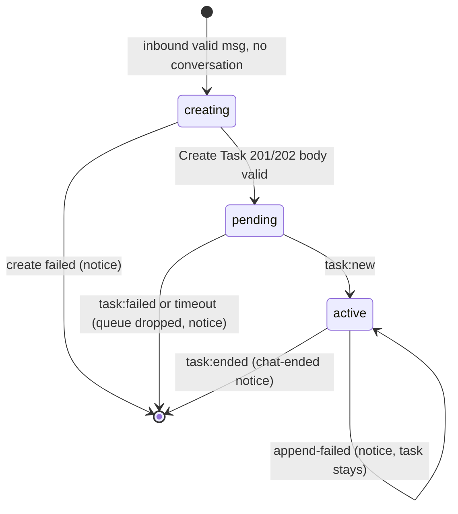

# Phase 1 Data Model

All state is in memory for the life of the process (no persistence).

## BridgeEnvelope (validated, `contracts/bridge-envelope.md`)
`pairId`, `eventId`, `receivedAt`, `contentType`, `payload`. Immutable; `payload` is not transformed.

## ClassifiedEvent
| Field | Values |
|-------|--------|
| `source` | `webex` \| `wxcc` \| `unknown` |
| `kind` | `webex.message.created`, `wxcc.task.new`, `wxcc.task.failed`, `wxcc.task.ended`, `wxcc.message.inbound`, `wxcc.message.outbound`, `wxcc.message.append-failed`, `unsupported` |
| `direction` | `data.direction` (lifecycle) or `data.messageDirection` (messages) |
| `bridge` | `{eventId, receivedAt}` |
| `payload` | original payload |
Produced before any handler runs; `unsupported`/`unknown` are logged `warn` and dropped.

## Conversation (key: Webex `roomId`)
| Field | Notes |
|-------|-------|
| `roomId` | Webex conversation id (primary key) |
| `personEmail` | Sender; sensitive, never logged raw |
| `taskId` | WxCC `data.id` from Create Task; set when response validated |
| `state` | `creating` → `pending` → `active` → (removed) |
| `queue` | Ordered pending messages `{messageId, text, timestamp, aliasId}` while `creating`/`pending` |
| `createdAt` / `pendingTimer` | For `PENDING_TASK_TIMEOUT_MS` |
Secondary index: `taskId → roomId`.

State transitions:

## ProcessedEventRegistry
Set of claimed idempotency keys (`bridge:`, `webex:message:`, `wxcc:event:`, `wxcc:msg:`, `wxcc:task:`). `claim(key)` returns false if present. Never evicted during the process lifetime.

## InboundMessage (derived, text-only)
`messageId`, `roomId`, `personEmail`, `text` (1..20000 chars after trim), `timestamp` (epoch ms from `created`), `aliasId` (generated UUID). Validation failures produce a `Rejection`.

## Rejection (log record)
`reason` ∈ `empty`, `non-text`, `malformed-envelope`, `malformed-payload`, `unsupported-event`, `unknown-source`, `wrong-direction`, `wrong-channel`, `business-address-sender`, `bot-sender`, `unknown-task`, `duplicate`; plus identifiers. Emitted as `warn`.

## TokenState (WxCC)
`accessToken` (memory only), `expiresAt`, `refreshToken` (memory; may rotate). Never logged.

## LogEntry
`timestamp` (ISO-8601), `level` (`info`|`warn`|`error`), `operation`, `outcome` (`success`|`failure`|`rejected`|`duplicate`|`skipped`), identifier fields, `error` (on failure).
