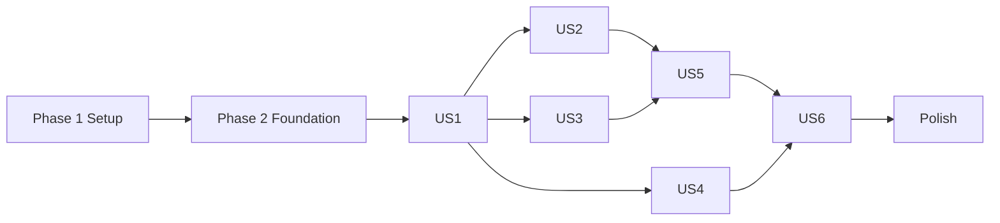

---

description: "Task list for Webex Messaging to WxCC BYOC middleware"
---

# Tasks: Webex Messaging to WxCC BYOC Middleware

**Input**: Design documents from `/specs/001-webex-wxcc-byoc/`

**Prerequisites**: [plan.md](./plan.md), [spec.md](./spec.md), [research.md](./research.md), [data-model.md](./data-model.md), [contracts/](./contracts), [quickstart.md](./quickstart.md)

**Tests**: REQUIRED. The plan mandates contract, unit, and in-process integration tests with production-shaped fixtures; tests precede implementation in each story. Automated tests never call live services.

**Organization**: Tasks are grouped by user story. Paths are relative to the repository root `C:\Users\User\Downloads\LAB_1_SPEC_49` (use `node:path` in code and tests; never hardcode separators).

## Format: `[ID] [P?] [Story] Description`

- **[P]**: Can run in parallel (different files, no dependency on incomplete tasks)
- **[Story]**: US1–US6 per [spec.md](./spec.md)

## Conventions that apply to every task

- Each external call in `src/clients/` carries a comment with the endpoint URL and spec source link (Constitution I).
- Use only the published schemas; no invented DTOs. Endpoint URL variables (`WXCC_TOKEN_URL`) are used verbatim; root variables get documented paths appended.
- Every API call, transition, routing decision, rejection, and failure calls `log()` from `src/log.js` (fixed levels: `info`, `warn`, `error`). Never log tokens, secrets, raw `personEmail`, or message text.
- Fixtures and docs use placeholder IDs and `example.com` addresses only.

---

## Phase 1: Setup

- [ ] T001 Create `package.json` with `"type": "module"`, `"engines": {"node": ">=26"}`, scripts `start` (`node src/index.js`), `test` (`node --test tests/`), `audit` (`npm audit --audit-level=moderate`), runtime dependencies `ajv` and `ajv-formats` only, and devDependency `ws` (test-only fake bridge WebSocket server; Node has no built-in server; Constitution IV justification recorded in plan.md)
- [ ] T002 [P] Create `.gitignore` excluding `node_modules/`, `.env`, `*.log`, and `manual-run.log`
- [ ] T003 [P] Create `.env.example` at repo root organized by service sections (Bridge, Webex, WxCC, Service) with the exact variables, kinds, and placeholders from `specs/001-webex-wxcc-byoc/contracts/configuration.md`; comment each URL as `# root (scheme + host only)` or `# endpoint (complete URL, used verbatim)`; placeholders only
- [ ] T004 [P] Create the directories from plan.md: `src/bridge/`, `src/events/`, `src/handlers/`, `src/state/`, `src/clients/`, `src/contracts/`, `scripts/`, `tests/fixtures/`, `tests/contract/`, `tests/unit/`, `tests/integration/` (files are added by later tasks)
- [ ] T005 Run `npm install` to create `package-lock.json`, then `npm audit --audit-level=moderate` and record zero findings (Constitution II)

---

## Phase 2: Foundational (blocks all user stories)

**⚠️ No user story work begins until this phase is complete.**

### Contracts and fixtures

- [ ] T006 Create `scripts/extract-schemas.js` that downloads `https://raw.githubusercontent.com/webex/webex-openapi-specs/main/public-spec/webex-contact-center.json` and `.../webex-messaging.json`, extracts verbatim the component schemas `CreateTaskRequestV2`, `CustomMessaging`, `CustomMessagingParams`, `TextMessage`, `TextWithAttachment`, `Attachment`, `CreateTaskResponse`, `TaskMessageRequest`, `CustomMessageAppendTaskRequest`, `TaskMessageResponse` and the Webex `Message` schema, bundles every transitive `$ref` target so each extract is self-contained, and writes them with a header of source URL and retrieval date (uses `node:path`)
- [ ] T007 Run `scripts/extract-schemas.js` to generate `src/contracts/wxcc-schemas.json` and `src/contracts/webex-schemas.json`
- [ ] T008 Implement `src/contracts/validators.js` exporting Ajv (strict off for OpenAPI keywords, `ajv-formats`) validators: `validateCreateTaskRequest`, `validateCreateTaskResponse`, `validateAppendRequest`, `validateAppendResponse`, `validateWebexMessage`; each returns `{valid, errors}` with errors safe to log (no data values); add `tests/unit/validators.test.js` asserting every validator compiles and accepts the fixture bodies
- [ ] T009 [P] Create production-shaped fixtures (placeholder ids, `example.com` emails) in `tests/fixtures/webex.js`: `messages.created` webhook (shape from `webhooks.md`), Get Message Details response (text-only, empty text, with `files`), Create Message response
- [ ] T010 [P] Create fixtures in `tests/fixtures/wxcc.js`: `task:new`, `task:failed` (`CONVERSATION_ALREADY_OPEN`), `task:ended`, inbound `task-message:appended`, outbound `task-message:appended` (system, agent, agent-with-attachments), `task-message:append-failed`, Create Task `201` and `202` response bodies, Append `202` body, error bodies (400, 401, 429, 500), token refresh response — shapes from `webhooks-cc.md` and `bring-your-own-custom-messaging-channel.md`
- [ ] T011 [P] Create fixtures in `tests/fixtures/bridge.js`: `wrap(payload, overrides)` building envelopes `{pairId, eventId, receivedAt, contentType: "application/json", payload}` plus malformed variants (bad JSON, wrong `pairId`, missing `eventId`, non-object payload)

### Core modules

- [ ] T012 Write unit tests `tests/unit/log.test.js`: one single-line JSON per call; fields `timestamp` (ISO-8601), `level` in `info|warn|error`, `operation`, `outcome` in `success|failure|rejected|duplicate|skipped`, identifiers, `error{name,message,status,reason}`; `info` → stdout, `warn`/`error` → stderr; redaction of keys matching `token|secret|authorization|refresh|password`, `Bearer …` and JWT-like values, emails (including `personEmail`/`origin`) masked, message text never emitted
- [ ] T012a [P] Create `src/handlers/rejection.js` (`reject(reason, ids)` logging `warn`/`error` with outcome `rejected`; reasons per data-model Rejection) and `src/messages.js` exporting the fixed notice constants `CHAT_ENDED_TEXT` and `DELIVERY_FAILED_TEXT` from spec Assumptions
- [ ] T013 Implement `src/log.js` (`log(level, operation, outcome, ids, error)` and `redact()`), passing T012
- [ ] T014 [P] Write unit tests `tests/unit/config.test.js`: missing/empty required variables fail naming variables only (never values); roots are scheme + host only (`https:`, `wss:` for `BRIDGE_WS_BASE_URL`), no path/query/trailing slash, subdomains allowed (FR-025); `WXCC_TOKEN_URL` must be `https:` and is returned unchanged; positive integers for `RECONNECT_DELAY_MS`, `RECONNECT_MAX_DELAY_MS`, `PENDING_TASK_TIMEOUT_MS`, `READINESS_PORT`; `PAIR_ID` matches `[a-zA-Z0-9_-]{1,64}`
- [ ] T015 Implement `src/config.js` using `process.loadEnvFile` (tolerate missing file when variables are already in the environment) returning a frozen config object; invalid config throws an error listing variable names, logged via `log()` as `config.validate` failure, passing T014
- [ ] T016 [P] Write unit tests `tests/unit/idempotency.test.js`: `claim(key)` returns true once then false; synchronous claim prevents concurrent double-processing; keys never evicted; failed processing leaves key claimed
- [ ] T017 [P] Implement `src/state/idempotency.js` (`claim(key)`, `has(key)`) passing T016
- [ ] T018 [P] Write unit tests `tests/unit/conversations.test.js` for the store in data-model.md: `roomId → {roomId, personEmail, taskId, state, queue}` and `taskId → roomId` indexes stay consistent; states `creating` → `pending` → `active`; removal clears both indexes and the timer; queue preserves arrival order; lookups in both directions
- [ ] T019 Implement `src/state/conversations.js` (`beginCreate`, `setPending(taskId)`, `activate`, `enqueue`, `drainQueue`, `byRoom`, `byTask`, `remove`, pending timer calling an injected `onTimeout`) passing T018

### Bridge boundary and classification

- [ ] T020 [P] Write unit tests `tests/unit/envelope.test.js`: valid envelope accepted with `payload` returned untouched; rejects bad JSON, non-object, `pairId` mismatch, missing/non-string `eventId` or `receivedAt`, `contentType` not `application/json`, non-object `payload`; unknown extra fields tolerated; rejection reason `malformed-envelope`
- [ ] T021 [P] Implement `src/bridge/envelope.js` (`parseEnvelope(raw, pairId)`) per `contracts/bridge-envelope.md`, passing T020
- [ ] T022 [P] Write unit tests `tests/unit/classify.test.js` covering the tables in `contracts/bridge-envelope.md` and `contracts/wxcc-webhooks.md`: Webex (`resource`+`event`+`data`) vs WxCC (`specversion`+`type`+`data`) vs `unknown` (neither or both); Webex requires `resource=messages`, `event=created`; WxCC kinds `task.new`, `task.failed`, `task.ended`, `message.inbound`, `message.outbound`, `message.append-failed`, else `unsupported`; lifecycle direction from `data.direction`, message direction from `data.messageDirection`; non-`customMessaging` `data.channelType` → `wrong-channel`; lifecycle `OUTBOUND` direction → `wrong-direction`
- [ ] T023 Implement `src/events/classify.js` (`classify(envelope)` → `{source, kind, direction, bridge:{eventId,receivedAt}, payload}` per the ClassifiedEvent model) passing T022; classification precedes any direction or lifecycle handling
- [ ] T024 Write integration test `tests/integration/bridge-socket.test.js` using a fake WebSocket server (`tests/fixtures/fake-bridge.js`, built on the `ws` devDependency, created in this task): client connects to `/v1/pairs/{encodeURIComponent(PAIR_ID)}/socket`; frames processed strictly in arrival order; disconnect → not-ready, bounded exponential backoff reconnect (`RECONNECT_DELAY_MS` up to `RECONNECT_MAX_DELAY_MS`); takeover close → logged `error`, no reconnect loop; malformed frames logged and skipped; no replay assumed
- [ ] T025 Implement `src/bridge/socket.js` (global `WebSocket`, serial processing queue, backoff, takeover handling, `isReady()`, injectable `onEvent`) passing T024; logs `bridge.connect`, `bridge.disconnect`, `bridge.reconnect`, `bridge.frame` with `bridgeEventId`
- [ ] T026 [P] Implement `src/readiness.js` (`node:http` server, `GET /ready` → 200 when `isReady()` else 503) and test in `tests/unit/readiness.test.js`

### Clients (shared by stories)

- [ ] T027 [P] Write contract tests `tests/contract/wxcc-auth.test.js` against a loopback mock: `POST` to the exact `WXCC_TOKEN_URL` (no appended path), `Content-Type: application/x-www-form-urlencoded`, body `grant_type=refresh_token`, `client_id`, `client_secret`, `refresh_token`; token cached; refreshed within 60 s of `expires_in` and once on `401`; rotated `refresh_token` kept in memory; refresh failure logged `error` with no secrets
- [ ] T028 Implement `src/clients/wxcc-auth.js` (`getAccessToken()`, `invalidate()`) per `contracts/wxcc-tasks.md` "Token refresh", passing T027
- [ ] T029 [P] Write contract tests `tests/contract/webex-client.test.js` against a loopback mock: `GET {WEBEX_API_ROOT_URL}/v1/messages/{messageId}` with `Authorization: Bearer <bot token>`, response validated by `validateWebexMessage`; `POST {WEBEX_API_ROOT_URL}/v1/messages` with `Content-Type: application/json`, body exactly `{roomId, text}`, success `200` body validated; non-2xx statuses (401, 404, 429, 500) raise errors carrying `status`, logged with redacted body
- [ ] T030 Implement `src/clients/webex.js` (`getMessage(id)`, `postMessage(roomId, text)`) passing T029, with endpoint URL + spec link comments
- [ ] T031 [P] Write contract tests `tests/contract/wxcc-client.test.js` against a loopback mock: `POST {WXCC_API_ROOT_URL}/v2/tasks` with `Authorization: Bearer`, `Content-Type: application/json`, body validated by `validateCreateTaskRequest` (CustomMessaging variant: `origin.id`, `destination{id,type:"businessAddress"}`, `channelType:"customMessaging"`, `channel`, `channelParams{type:"text",message{aliasId,text,timestamp}}`); success statuses `201` and the approved `202` (DEV-001) both accepted only for this endpoint; body validated by `validateCreateTaskResponse` (invalid/missing `data.id` → failure); `POST {WXCC_API_ROOT_URL}/v2/tasks/{taskId}/messages` with body validated by `validateAppendRequest` (`mediaType:"customMessaging"`), only `202` accepted, body validated by `validateAppendResponse`; `/v1/tasks` never called; `401` triggers one token refresh and retry; 400/403/429/500/503 surface as failures
- [ ] T032 Implement `src/clients/wxcc.js` (`createTask({personEmail, text, timestamp, aliasId})`, `appendMessage(taskId, {text, timestamp, aliasId})`) passing T031; the `202` acceptance for create is gated by a named constant referencing `deviations.md` DEV-001 and logs `deviation: "DEV-001"`; request bodies validated before send

**Checkpoint**: Foundation ready; user stories may start.

---

## Phase 3: User Story 1 — Webex user starts a contact-center chat (P1) 🎯 MVP

**Goal**: A valid first inbound Webex text message creates exactly one WxCC task with `Origin.id` = `personEmail` and stores the conversation↔task association.

**Independent Test**: Deliver one `messages.created` envelope for a room with no task; assert one `POST /v2/tasks` with the contract body, `202` accepted, association stored, `task:new` activates it.

### Tests for US1

- [ ] T033 [P] [US1] Write integration test `tests/integration/us1-create-task.test.js` (fake bridge + mock Webex + mock WxCC): valid message → `GET /v1/messages/{id}` then one `POST /v2/tasks` with `origin.id` = fixture `personEmail`; response `202` (DEV-001) and `201` both succeed; store has `taskId` and state `pending`; `task:new` envelope moves to `active`
- [ ] T034 [P] [US1] Extend `tests/integration/us1-create-task.test.js`: create failure (400/500 or invalid body) → `wxcc.create-task` failure log, no association stored, one delivery-failed `POST /v1/messages` to the room, no retry (FR-011b)
- [ ] T034a [P] [US1] Extend `tests/integration/us1-create-task.test.js`: `GET /v1/messages/{id}` failure (404/500) and failure of the delivery-failed `POST /v1/messages` are logged with identifiers, trigger no WxCC call and no retry, and do not block the next event (FR-011d)
- [ ] T035 [P] [US1] Write unit tests `tests/unit/webex-inbound.test.js` for text-only extraction: accept when `text` is 1..20000 chars after trim, `files` and `attachments` absent or empty; `timestamp` = epoch ms of `created`; `aliasId` is a UUID

### Implementation for US1

- [ ] T035a [US1] Implement `validateInboundMessage(message)` in `src/handlers/webex-inbound.js`: reject (`reject()` reasons `empty` or `non-text`) when `text` is missing, empty or whitespace-only, longer than 20000 chars, `files` is non-empty, or `attachments` is non-empty; passes T035, T061, and runs before any `createTask` or `appendMessage`
- [ ] T036 [US1] Implement `src/handlers/webex-inbound.js` `handleWebexMessage(event)`: claim `webex:message:{data.id}`, fetch message (on fetch failure log `error` `webex.get-message`, no retry), run `validateInboundMessage`, build `InboundMessage`, create the conversation (`creating`), call `createTask`, store `taskId` (`pending`) and start pending timer, log each step (`webex.get-message`, `wxcc.create-task`, `task.pending`)
- [ ] T037 [US1] Implement `src/handlers/wxcc-events.js` `handleTaskNew(event)`: claim `wxcc:task:task:new:{taskId}`, require `channelType` `customMessaging` and `data.direction` `INBOUND` (direction filtering applies to `task:new` only), activate the conversation by `byTask`, cancel the pending timer, log `task.active`
- [ ] T038 [US1] Handle the create/response race in `src/handlers/webex-inbound.js` and `src/handlers/wxcc-events.js`: a `task:new` or `task:failed` arriving while the room is still `creating` is buffered and re-evaluated after `setPending`
- [ ] T039 [US1] Wire dispatch in `src/handlers/index.js` (`dispatch(classified)`): `webex.message.created` → T036, `wxcc.task.new` → T037; `unknown`/`unsupported` → `warn` rejection log
- [ ] T040 [US1] Create `src/index.js` wiring config, clients, store, registry, dispatcher, bridge socket, and readiness server; log startup `config.validate` and `ready`

**Checkpoint**: US1 independently functional (MVP).

---

## Phase 4: User Story 2 — Follow-up messages append to the active task (P1)

**Goal**: Messages from a conversation with an active task are appended to it in order; messages during `pending` are queued and flushed after `task:new`.

**Independent Test**: With an active association deliver a second message; assert one `POST /v2/tasks/{taskId}/messages`, no new task.

### Tests for US2

- [ ] T041 [P] [US2] Write integration test `tests/integration/us2-append.test.js`: active conversation → one append with `mediaType:"customMessaging"`, `channelParams.type:"text"`, `202` accepted; no `POST /v2/tasks`
- [ ] T042 [P] [US2] Extend test: messages arriving in `pending` are queued in arrival order and appended in that order after `task:new` (FR-011a); only one task is created
- [ ] T043 [P] [US2] Extend test: `task:failed` while pending discards queued messages, sends one delivery-failed notice, clears the association
- [ ] T044 [P] [US2] Extend test: after `task:ended` clears the association, the next message creates a new task (Acceptance Scenario 2)
- [ ] T045 [P] [US2] Extend test (FR-011c): pending timeout (`PENDING_TASK_TIMEOUT_MS`, fake timers) acts like `task:failed`
- [ ] T046 [P] [US2] Extend test: append failure (non-202 or `task-message:append-failed` event) sends one delivery-failed notice and does not retry (FR-011b)

### Implementation for US2

- [ ] T047 [US2] Extend `handleWebexMessage` in `src/handlers/webex-inbound.js`: `active` → serialized per-room append via `appendMessage`; `creating`/`pending` → `enqueue`
- [ ] T048 [US2] Implement queue flush in `src/handlers/wxcc-events.js`: after `task:new` drain the queue sequentially through `appendMessage`, logging `task.append` per message
- [ ] T049 [US2] Implement `handleTaskFailed` in `src/handlers/wxcc-events.js`: claim `wxcc:task:task:failed:{taskId}`, log `data.reason`/`data.errorMessage` (e.g. `CONVERSATION_ALREADY_OPEN`), discard queue, send delivery-failed notice via `postMessage`, remove conversation
- [ ] T050 [US2] Implement pending-timeout callback and `handleAppendFailed` (kind `wxcc.message.append-failed`, claim `wxcc:event:{id}`) in `src/handlers/wxcc-events.js` sending the delivery-failed notice and logging
- [ ] T051 [US2] Register new kinds in `src/handlers/index.js`

**Checkpoint**: US1 + US2 work together.

---

## Phase 5: User Story 3 — Agent replies reach the Webex user (P1)

**Goal**: Outbound `task-message:appended` events (`data.messageDirection` = `OUTBOUND`) post to the associated Webex room once and never go back to WxCC.

**Independent Test**: Deliver an outbound event for a known task; assert one `POST /v1/messages` to the right `roomId` and zero WxCC calls.

### Tests for US3

- [ ] T052 [P] [US3] Write integration test `tests/integration/us3-outbound.test.js`: system and agent outbound events → one Webex post each with `{roomId, text}` from `data.channelParams.message.text`; zero requests to the WxCC mock
- [ ] T053 [P] [US3] Extend test: inbound `task-message:appended` (`messageDirection` `INBOUND`) causes no Webex post and no WxCC call (logged `skipped`)
- [ ] T054 [P] [US3] Extend test: unknown `taskId` → no post, `warn` rejection `unknown-task`
- [ ] T055 [P] [US3] Extend test: outbound with attachments posts text only and logs a `warn` that attachments were dropped; empty text with attachments → rejected `non-text`/`empty` (research R-11)

### Implementation for US3

- [ ] T056 [US3] Implement `handleOutboundMessage` in `src/handlers/wxcc-events.js`: evaluate `data.messageDirection`; `OUTBOUND` only; claim `wxcc:event:{id}` and `wxcc:msg:{taskId}:{aliasId}` (either hit → duplicate); look up room by `taskId`; `postMessage(roomId, text)`; log `routing.outbound`; never call WxCC
- [ ] T057 [US3] Implement `handleInboundEcho` (kind `wxcc.message.inbound`) in `src/handlers/wxcc-events.js`: log `skipped`; no calls
- [ ] T058 [US3] Register kinds in `src/handlers/index.js`

**Checkpoint**: Two-way conversation works.

---

## Phase 6: User Story 5 — Safe handling of loops, duplicates, and bad input (P1)

**Goal**: Business-address and bot messages are ignored; replays are idempotent; invalid payloads are rejected before any WxCC call and logged.

**Independent Test**: Replay events, send business-address and invalid messages; assert no extra task, append, or Webex post, and one log record per outcome.

### Tests for US5

- [ ] T059 [P] [US5] Write integration test `tests/integration/us5-loops.test.js`: `personEmail` equal to `WXCC_BUSINESS_ADDRESS` (and `WEBEX_BOT_EMAIL`, case-insensitive) → no Get Message needed, no WxCC call, rejection `business-address-sender`/`bot-sender`
- [ ] T060 [P] [US5] Write integration test `tests/integration/us5-duplicates.test.js`: same Webex envelope twice (including different bridge `eventId`s) → one create/append; replayed outbound event (same `id`, and same `aliasId` with different `id`) → one Webex post; replayed `task:ended`/`task:new`/`task:failed` handled once; concurrent duplicates processed once
- [ ] T061 [P] [US5] Write integration test `tests/integration/us5-rejections.test.js`: empty text, whitespace-only, `files` present, non-`messages` resource, non-`created` event, malformed envelope, wrong `pairId`, unknown source, unsupported WxCC type, wrong channel, lifecycle `OUTBOUND` direction on `task:new` → no WxCC call, `warn`/`error` log with `reason` ∈ `empty|non-text|malformed-envelope|malformed-payload|unsupported-event|unknown-source|wrong-direction|wrong-channel|business-address-sender|bot-sender|unknown-task|duplicate`

### Implementation for US5

- [ ] T062 [US5] Add sender guards at the top of `handleWebexMessage` in `src/handlers/webex-inbound.js` (compare `data.personEmail`, then the fetched message's `personEmail`, to `WXCC_BUSINESS_ADDRESS` and `WEBEX_BOT_EMAIL` case-insensitively) before any WxCC call
- [ ] T063 [US5] Ensure every rejection path uses `reject()` from `src/handlers/rejection.js` across `src/handlers/index.js`, `webex-inbound.js`, `wxcc-events.js`, and the bridge socket
- [ ] T064 [US5] Log the bridge `eventId` on every record (no registry claim; the bridge id is unique per delivery per research R-06) and ensure duplicate outcomes from payload-based keys log `outcome: "duplicate"` with the original key
- [ ] T065 [US5] Validate embedded payload shape before routing in `src/events/classify.js` (required `data` fields per kind; missing → `malformed-payload`)

**Checkpoint**: Loop, replay, and bad-input protection verified.

---

## Phase 7: User Story 4 — Customer is told when the chat ends (P2)

**Goal**: `task:ended` posts one chat-ended message and clears the association; other lifecycle events do not.

**Independent Test**: Deliver `task:ended` for an active task; assert one Webex notice and the next message creates a new task.

### Tests for US4

- [ ] T066 [P] [US4] Write integration test `tests/integration/us4-ended.test.js`: `task:ended` (any `data.direction`) → one chat-ended post to the room, conversation removed, later message creates a new task
- [ ] T067 [P] [US4] Extend test: unknown task → no post (`unknown-task`); duplicate `task:ended` → one post; other lifecycle types (for example `task:connected`) → no post (`unsupported-event`)

### Implementation for US4

- [ ] T068 [US4] Implement `handleTaskEnded` in `src/handlers/wxcc-events.js`: claim `wxcc:task:task:ended:{taskId}`, look up room by `taskId`, post the chat-ended text, remove conversation, log `task.ended` and `conversation.cleared`
- [ ] T069 [US4] Register `wxcc.task.ended` in `src/handlers/index.js`

---

## Phase 8: User Story 6 — Operator can trust configuration, auth, and logs (P2)

**Goal**: Invalid configuration blocks processing; all activity is traceable in redacted structured logs.

**Independent Test**: Start with a missing variable and observe refusal; scan logs from a full integration run for secrets.

### Tests for US6

- [ ] T070 [P] [US6] Write `tests/integration/us6-startup.test.js`: process with a missing required variable exits non-zero without opening the socket, logging variable names only; valid config opens the socket and `/ready` becomes 200
- [ ] T071 [P] [US6] Write `tests/integration/us6-log-audit.test.js`: run the US1–US5 flows with sentinel secrets (`SENTINEL_BOT_TOKEN`, `SENTINEL_CLIENT_SECRET`, `SENTINEL_REFRESH_TOKEN`, a sentinel email and message text); assert no sentinel appears in captured stdout/stderr, every captured line is single-line JSON with required fields, and each API call/transition/rejection/failure has a matching entry
- [ ] T072 [P] [US6] Write `tests/unit/env-example.test.js`: `.env.example` contains every variable in `contracts/configuration.md` grouped by service, root URLs have no path, values are placeholders, and no real-looking secrets

### Implementation for US6

- [ ] T073 [US6] Make `src/index.js` fail fast on invalid configuration (log, exit code 1, no socket) and handle `SIGINT`/`SIGTERM` by closing socket and readiness server
- [ ] T074 [US6] Add a global `unhandledRejection`/`uncaughtException` handler in `src/index.js` that logs `error` with correlation data (no silent failures)

---

## Phase 9: Polish & Cross-Cutting

- [ ] T075 [P] Write `README.md` at repo root: purpose, Node 26 requirement, setup (`.env.example` → `.env`), `npm test`, `npm start`, link to `specs/001-webex-wxcc-byoc/quickstart.md` manual workflow, and the in-memory limitation
- [ ] T076 [P] Add a cross-platform path check `tests/unit/paths.test.js` asserting no source or test file hardcodes `/` or `\` in filesystem path construction (use `node:path`, `node:url`)
- [ ] T077 [P] Add a secrets scan `tests/unit/artifact-scan.test.js` over `src/`, `tests/`, `README.md`, `.env.example`, `deviations.md`, and `specs/` for token-like strings, `Bearer <value>`, and non-`example.com` emails
- [ ] T078 Add contract tests asserting every `src/clients/` call site has an endpoint-URL + spec-link comment and that `deviations.md` contains DEV-001 matching the `202` constant in `src/clients/wxcc.js` (`tests/contract/deviation-trace.test.js`)
- [ ] T079 Run `npm test` and `npm audit --audit-level=moderate`; fix findings; record zero findings
- [ ] T080 Execute the manual workflow in `specs/001-webex-wxcc-byoc/quickstart.md` against the hosted bridge and live services; save redacted evidence (log excerpts per step) and note any deviation in `deviations.md`
- [ ] T081 Re-run the checklist in `specs/001-webex-wxcc-byoc/checklists/requirements.md` against the implemented behavior and update the spec/plan if behavior diverged

---

## Dependencies & Execution Order

- **Phase 1 → Phase 2 → stories → Phase 9.** Phase 2 blocks everything.
- **US1** (Phase 3) is the MVP and creates `src/handlers/*` and `src/index.js`; US2, US3, US4, US5 extend those files, so they run sequentially in file terms but their **tests** (marked [P]) can be written in parallel.
- **US2** depends on US1 (association, `task:new`). **US3** depends on US1 (association lookup by `taskId`). **US4** depends on US1. **US5** depends on US1–US3 handlers existing (it hardens them). **US6** depends on US1 for `src/index.js`; its tests depend on US1–US5 flows.
- Within a story: tests first (must fail), then implementation.



## Parallel Opportunities

- Phase 1: T002, T003, T004.
- Phase 2: fixtures T009–T011; test files T012/T014/T016/T018/T020/T022/T027/T029/T031 are independent files; implementations T017, T019, T021, T026, T030 once their tests exist.
- Each story's test tasks (marked [P]) touch different files or extend a single file sequentially (the "Extend" tasks edit the same file and must be applied in order).
- Phase 9: T075–T077.

### Example: Phase 2 in parallel

```text
Developer A: T012 → T013 (log), T014 → T015 (config)
Developer B: T020 → T021 (envelope), T022 → T023 (classify), T024 → T025 (socket)
Developer C: T027 → T028 (auth), T029 → T030 (Webex client), T031 → T032 (WxCC client)
Anyone:      T009, T010, T011 (fixtures), T016 → T017, T018 → T019
```

## Implementation Strategy

1. **MVP**: Phases 1–3 (US1): a Webex message creates a WxCC task with `Origin.id` = `personEmail`. Validate with T033–T035 and the manual steps 1–3 in quickstart.
2. **Increment 1**: US2 + US3 for a usable two-way chat.
3. **Increment 2**: US5 hardening (loops, replays, rejections) before any live demo.
4. **Increment 3**: US4 closure notice, then US6 operator checks.
5. Finish with Phase 9 and the manual live validation (T080).

## Task Summary

- Total tasks: 84 (original 81 plus T012a, T034a, T035a)
- Setup 5, Foundational 27 (T006–T032), US1 8 (T033–T040), US2 11 (T041–T051), US3 7 (T052–T058), US5 7 (T059–T065), US4 4 (T066–T069), US6 5 (T070–T074), Polish 7 (T075–T081)
